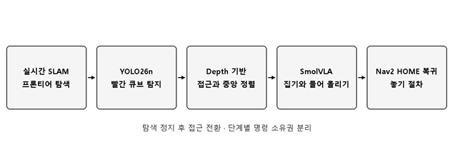

# JetRover · Autonomous Cube Collection in Isaac Sim

JetRover가 실내를 탐색해 빨간 큐브를 찾고, 집어서 출발 위치로 가져오는 ROS 2 프로젝트입니다. Isaac Sim에서 주행과 팔 조작을 연결하고, 탐색부터 내려놓기까지의 동작을 시연했습니다.

## Isaac Sim 시연

왼쪽은 Isaac Sim의 로봇 움직임이고, 오른쪽은 RViz의 카메라 영상과 주행 지도입니다. 주행 중 지도가 넓어지고, 큐브를 발견하면 탐색을 멈춰 접근합니다. 이후 팔로 큐브를 들어 올리고, 차체가 출발 위치로 돌아와 큐브를 내려놓습니다. [통합 시연 보기 · 약 44초, 8배속](media/mission-demo.gif)

## 시스템 동작

### 1. 지도 작성과 탐색 주행

SLAM Toolbox가 라이다 스캔과 로봇의 이동 정보를 이용해 주행 중 2D 지도를 갱신합니다. `frontier_exploration_ros2`는 관측된 빈 공간과 미관측 공간이 맞닿는 경계에서 다음 탐색 목표를 선택합니다. Nav2는 그 목표까지 코스트맵과 차체 외곽을 고려해 경로를 계산하고, 경로를 따라갈 속도 명령을 생성합니다.

### 2. 빨간 큐브 검출과 접근

YOLO26n으로 RGB 영상에서 큐브의 검출 상자를 찾습니다. 상자의 가로 중심을 화면 중앙과 비교해 왼쪽으로 벗어나면 좌회전하고, 오른쪽으로 벗어나면 우회전합니다. 화면 폭의 ±2%에 해당하는 중앙 허용 범위 안에서 전진합니다. 검출 영역의 Depth를 차체 좌표계인 `base_link`로 변환하고, 중앙 정렬 상태에서 추정한 큐브 표면의 전방 좌표가 0.25m 이내에 들어오면 정지합니다.

### 3. SmolVLA 집기

손목 카메라 RGB 한 장, 팔과 집게의 실제 관절각 6개, 작업 지시를 추론 서버로 보냅니다. 서버는 50개 시점의 목표 관절각을 예측합니다. 집기 클라이언트는 예측 결과의 앞부분을 차례로 ROS 2 관절 명령으로 보내고, 새 영상과 관절 상태를 받아 다시 추론합니다.

파인튜닝에는 Isaac Sim에서 기록한 **시범 50개, 총 29,204프레임**을 사용했습니다. RGB 영상, 실제 관절각, 시범 중에 보낸 목표 관절각을 30Hz 기준으로 정렬했습니다. 실제 관절각은 모델 입력으로, 시범에서 보낸 목표 관절각은 학습 정답으로 사용했습니다. SmolVLA는 20,000스텝 학습했습니다.

### 4. 출발 위치 복귀와 내려놓기

탐색을 시작할 때 지도 좌표계에 출발 위치와 방향을 기록합니다. 집기 동작이 끝나면 차체를 Nav2로 출발 위치까지 이동시키고, 도착 상태를 받은 뒤 팔을 내려 집게를 여는 동작을 실행합니다. 작업 상태 머신이 단계 전환을 관리하고, 속도 전달 노드는 탐색과 접근 중 현재 단계에 맞는 차체 명령을 전달합니다.

## 주요 코드

| 기능 | 읽어볼 파일 |
| --- | --- |
| 실시간 SLAM·Nav2 실행과 프론티어 연동 | [navigation.launch.py](src/jetrover_navigation/launch/navigation.launch.py), [exploration.launch.py](src/jetrover_navigation/launch/exploration.launch.py) |
| 탐색 시작·정지, HOME 복귀, 지역 코스트맵 좌표 변환 | [frontier_bridge.py](src/jetrover_navigation/scripts/frontier_bridge.py), [costmap_projection.py](src/jetrover_navigation/scripts/costmap_projection.py) |
| 작업 상태 전환과 차체 속도 명령 선택 | [mission_core.py](src/jetrover_bringup/scripts/mission_core.py), [velocity_gate.py](src/jetrover_bringup/scripts/velocity_gate.py) |
| RGB·Depth 정합과 검출 위치 계산 | [detector.py](src/jetrover_vision/scripts/detector.py), [geometry.py](src/jetrover_vision/scripts/geometry.py) |
| 접근 시 좌우 정렬·정지 조건과 감속 | [approach_status.py](src/jetrover_vision/scripts/approach_status.py), [approach_velocity.py](src/jetrover_vision/scripts/approach_velocity.py) |
| 팔 관측·모델 추론·관절 명령 연결 | [grasp_client.py](src/jetrover_manipulation/scripts/grasp_client.py), [policy_server.py](src/jetrover_manipulation/scripts/policy_server.py) |
| 출발 위치 도착 후 물체 내려놓기 | [place_client.py](src/jetrover_manipulation/scripts/place_client.py), [place_plan.py](src/jetrover_manipulation/scripts/place_plan.py) |

## 공개 범위와 출처

이 저장소에는 핵심 구현과 개발 버전에서 촬영한 Isaac Sim 시연을 담았습니다. 전체 실행 환경과 모델 가중치는 포함하지 않습니다. 시연의 확인 범위는 Isaac Sim에서의 통합 동작입니다.

`navigation`과 `slam`은 제조사 공식 저장소에서 확인할 수 있습니다. [Hiwonder JetRover](https://github.com/Hiwonder/JetRover/tree/Jetson_Orin_ros2)

## 사용한 프로젝트

- [NVIDIA Isaac Sim](https://docs.isaacsim.omniverse.nvidia.com/)
- [SLAM Toolbox](https://github.com/SteveMacenski/slam_toolbox) · [Nav2](https://github.com/ros-navigation/navigation2) · [frontier_exploration_ros2](https://github.com/mertgulerx/frontier_exploration_ros2)
- [Ultralytics YOLO26](https://docs.ultralytics.com/models/yolo26/) · [LeRobot SmolVLA](https://huggingface.co/docs/lerobot/smolvla)
