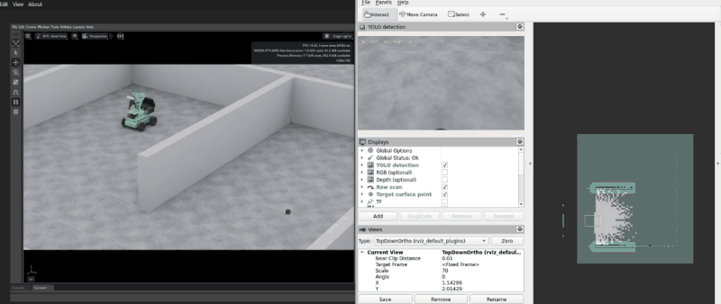
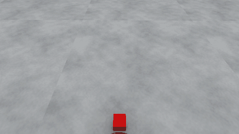
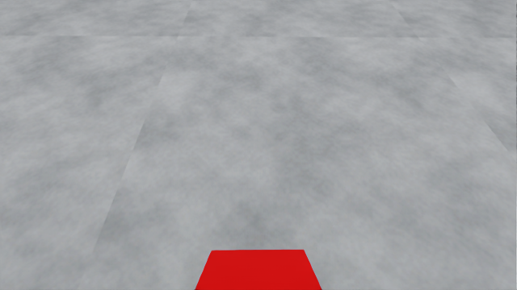
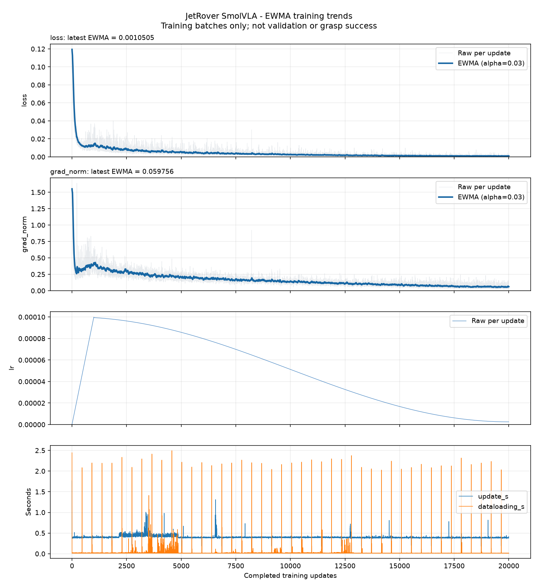

# JetRover · Autonomous Cube Collection in Isaac Sim

JetRover가 실내를 탐색해 빨간 큐브를 찾고, 집어서 출발 위치로 가져오는 ROS 2 프로젝트입니다. Isaac Sim에서 주행과 팔 조작을 연결하고, 탐색부터 내려놓기까지의 동작을 시연했습니다.

## Isaac Sim 시연

벽으로 나뉜 실내에서 탐색을 시작해, 지도를 넓혀 가며 빨간 큐브를 찾습니다. 큐브를 발견하면 접근해 들어 올린 뒤 출발 위치로 돌아와 내려놓습니다. 왼쪽은 Isaac Sim의 로봇 움직임, 오른쪽은 RViz의 카메라 영상·지도·경로입니다. 

 

 

## 시스템 동작

### 1. 지도 작성과 탐색 주행

SLAM Toolbox가 라이다 스캔을 이전 관측과 맞추면서 로봇의 위치와 방향을 보정하고, 관측한 빈 공간과 장애물을 5cm 격자 지도에 기록합니다. `frontier_exploration_ros2`는 빈 공간과 미관측 공간이 맞닿는 경계를 후보로 묶고, 이동 부담과 경계 크기를 고려하는 Greedy MRTSP 방식으로 다음 탐색 목표를 선택합니다.

Nav2는 전역 코스트맵을 이용해 목표까지의 경로를 계산하고, 지역 코스트맵과 차체 외곽을 고려해 경로를 따라갈 속도를 제어합니다. 탐색 모듈이 로봇 주변의 장애물 비용을 지도와 같은 좌표계에서 참조할 수 있도록, 주행 연결 코드에서 지역 코스트맵을 `map` 좌표계의 격자로 변환합니다.

### 2. 빨간 큐브 검출과 접근

탐색 중에도 YOLO26n으로 RGB 영상에서 빨간 큐브(`redblock`)를 검출합니다. 탐색에서 접근으로 전환할 때는 검출 상자 전체가 가로 중앙 50%와 화면 상단 10% 아래로 들어왔는지 확인합니다. 이 범위는 화면 가장자리에 걸친 검출 때문에 주행을 멈추는 경우를 줄이기 위해 두었습니다. 탐색 중지 요청에 대한 응답과 정지 상태를 차례로 받은 뒤 접근을 시작합니다.

접근할 때는 검출 상자의 좌우 경계 평균으로 가로 중심을 구합니다. 중심이 화면 폭의 ±2%에 해당하는 허용 범위를 벗어나면 큐브가 있는 쪽으로 회전하고, 범위 안에서는 전진합니다. 깊이 영상은 RGB 영상에 정합하고, 검출 상자 내부의 유효한 깊이값으로 큐브 표면 위치를 추정합니다. 이 위치를 TF로 차체 좌표계인 `base_link`에 옮긴 뒤, 좌우 정렬 상태에서 전방 좌표가 0.25m 이내이면 차체를 정지합니다.

### 3. SmolVLA 집기

집기 클라이언트는 손목 카메라 RGB 한 장, 팔 5개와 집게 1개의 실제 관절각, 작업 지시를 추론 서버로 보냅니다. 모델은 한 번에 50개 시점의 절대 목표 관절각을 예측합니다. Isaac Sim 통합 설정에서는 앞의 30개를 시뮬레이션 시간 기준 30Hz로 실행한 뒤, 새 영상과 관절 상태를 받아 다시 추론합니다.

### 4. 출발 위치 복귀와 내려놓기

초기 지도와 차체의 위치가 확인되면 지도 좌표계에 출발 위치와 방향(HOME)을 기록합니다. 집기 동작이 끝나면 팔과 집게의 마지막 목표 자세를 유지한 채, 저장한 위치와 방향을 Nav2 복귀 목표로 보냅니다. 도착 상태를 받은 뒤에는 팔을 내리고 집게를 열어 큐브를 놓은 다음 팔을 초기 자세로 돌립니다.

작업 상태 머신은 탐색 중지, 접근 완료, 집기 동작 종료, HOME 도착을 기준으로 다음 단계를 시작합니다. 속도 전달 노드는 단계에 맞춰 Nav2와 접근 제어 중 한쪽의 차체 명령만 전달합니다.

## SmolVLA 학습 데이터셋

Isaac Sim에서 관절 명령으로 집기 시범을 실행해 **큐브 배치 10가지 × 배치별 접근 동작 5가지 = 50개 에피소드**를 기록했습니다. 각 에피소드는 팔의 초기 자세에서 시작해 **집게 열기 → 방향 맞추기 → 접근·하강 → 집기 → 들어 올리기 → 팔 초기 자세로 복귀·유지**까지 이어집니다.

### 시범 동작 설계

- **큐브 배치 10가지.** 3 cm 큐브의 높이는 고정했습니다. 시뮬레이터 월드 좌표에서 전후 위치(X)는 0.245–0.255 m, 좌우 위치(Y)는 −0.020–+0.020 m, Z축 회전은 −15°부터 +15°까지 바꿨습니다.
- **배치별 접근 동작 5가지.** 기준 접근 1개와 어깨·팔꿈치 각도를 조금씩 바꾼 접근 4개를 사용했습니다. 차이는 접근 초반에만 적용했고, 같은 배치의 다섯 동작은 하강하기 전에 공통 경로로 합류합니다. 큐브의 배치와 접근 궤적에 변화를 주면서도 같은 배치에서 집기 직전의 자세는 일정하게 유지했습니다.

### 프레임 구성과 시간 정렬

ROS 2 bag으로 기록한 영상과 관절 데이터를 시뮬레이션 시간 기준 **30Hz**로 맞췄습니다. 각 프레임 시각에는 영상·실제 관절각·목표 관절각 각각에서 그 시각까지 기록된 가장 최신 값을 사용했습니다. 변환한 SmolVLA용 LeRobot 데이터셋은 총 **29,204프레임**입니다.

| 데이터 | 학습에서 사용하는 방식 |
| --- | --- |
| 손목 카메라 RGB 이미지 1장 | 현재 관측 입력 |
| 실제 관절각 6개 | 팔 관절 5개와 집게 관절 1개의 측정 각도. 현재 상태 입력 |
| 작업 지시 | 빨간 큐브를 집어 팔을 초기 자세로 돌리고 유지하라는 공통 지시 |
| 목표 관절각 6개 | 같은 시점에 시범 제어기가 보낸 각 관절의 절대 목표 각도(rad). 학습 정답 |

학습할 때는 한 시점의 RGB, 실제 관절각, 작업 지시를 입력으로 사용합니다. 학습 정답은 해당 시점부터 **50개 시점**의 목표 관절각을 묶은 `50 × 6` 배열입니다. 이 데이터로 SmolVLA를 **20,000스텝** 파인튜닝했습니다.

### 손목 카메라 RGB 예시

첫 번째 에피소드는 **총 586프레임**이며, 프레임 번호는 **0번부터 585번까지**입니다.

*첫 번째 에피소드의 511번 프레임 · 시작 후 17.03초 · RGB 640 × 360*

| 관절 | 실제 관절각 (rad) | 목표 관절각 (rad) |
| --- | ---: | ---: |
| `joint1` | 0.0004 | 0.0000 |
| `joint2` | -0.8175 | -0.8370 |
| `joint3` | 2.0276 | 2.0365 |
| `joint4` | 1.2033 | 1.1917 |
| `joint5` | -0.0011 | 0.0000 |
| `r_joint` | 0.5000 | 0.5000 |

**작업 지시** · `Pick up the red cube, return to the home pose, and hold it.`

### SmolVLA 파인튜닝 결과

20,000스텝 동안 기록한 학습 배치 지표입니다. 학습 손실의 마지막 지수이동평균(EWMA)은 **0.00105**입니다.

## 주요 코드

| 기능 | 읽어볼 파일 |
| --- | --- |
| 실시간 SLAM·Nav2 실행과 프론티어 연동 | [navigation.launch.py](src/jetrover_navigation/launch/navigation.launch.py), [exploration.launch.py](src/jetrover_navigation/launch/exploration.launch.py) |
| 탐색 시작·정지, HOME 복귀, 지역 코스트맵 좌표 변환 | [frontier_bridge.py](src/jetrover_navigation/scripts/frontier_bridge.py), [costmap_projection.py](src/jetrover_navigation/scripts/costmap_projection.py) |
| 작업 상태 전환과 차체 속도 명령 선택 | [mission_core.py](src/jetrover_bringup/scripts/mission_core.py), [velocity_gate.py](src/jetrover_bringup/scripts/velocity_gate.py) |
| RGB·Depth 정합과 검출 위치 계산 | [detector.py](src/jetrover_vision/scripts/detector.py), [geometry.py](src/jetrover_vision/scripts/geometry.py) |
| 접근 시 좌우 정렬·정지 조건과 감속 | [approach_status.py](src/jetrover_vision/scripts/approach_status.py), [approach_velocity.py](src/jetrover_vision/scripts/approach_velocity.py) |
| 팔 관측·모델 추론·관절 명령 연결 | [grasp_client.py](src/jetrover_manipulation/scripts/grasp_client.py), [policy_server.py](src/jetrover_manipulation/scripts/policy_server.py) |
| 출발 위치 도착 후 물체 내려놓기 | [place_client.py](src/jetrover_manipulation/scripts/place_client.py), [place_plan.py](src/jetrover_manipulation/scripts/place_plan.py) |

## 공개 범위와 출처

이 저장소에는 핵심 구현과 개발 버전에서 촬영한 Isaac Sim 시연을 담았습니다. 전체 실행 환경과 모델 가중치는 포함하지 않습니다. 시연의 확인 범위는 Isaac Sim에서의 통합 동작입니다.

`navigation`과 `slam`은 제조사 공식 저장소에서 확인할 수 있습니다. [Hiwonder JetRover](https://github.com/Hiwonder/JetRover/tree/Jetson_Orin_ros2)

## 사용한 프로젝트

- [NVIDIA Isaac Sim](https://docs.isaacsim.omniverse.nvidia.com/)
- [SLAM Toolbox](https://github.com/SteveMacenski/slam_toolbox) · [Nav2](https://github.com/ros-navigation/navigation2) · [frontier_exploration_ros2](https://github.com/mertgulerx/frontier_exploration_ros2)
- [Ultralytics YOLO26](https://docs.ultralytics.com/models/yolo26/) · [LeRobot SmolVLA](https://huggingface.co/docs/lerobot/smolvla)
